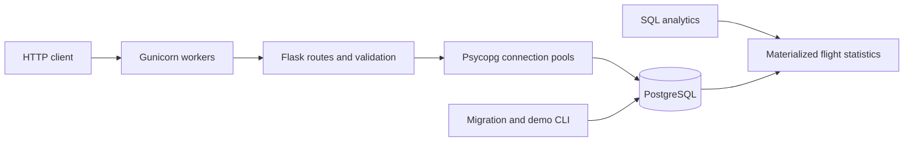
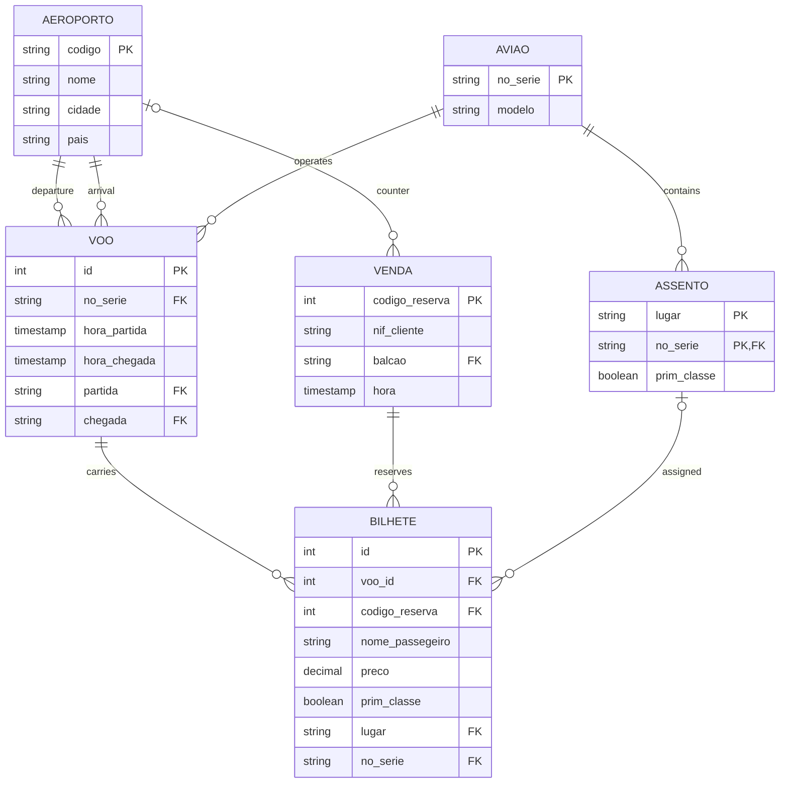

# Aviation Database API


[](.github/workflows/ci.yml)

A small Flask and PostgreSQL API for querying flights, purchasing tickets and
assigning seats at check-in. It began as a university group project and was later
improved for portfolio presentation, with a focus on transaction correctness,
database integrity, reproducible setup and integration testing.

The central problem is keeping ticket inventory and seat assignments consistent
when requests arrive concurrently. PostgreSQL enforces these rules, including
when writes bypass Flask. There is no frontend, payment processing or external
university infrastructure required to run the project.

## Features and stack

- List airports, query departures in the next twelve hours, and find the next three available flights on a route.
- Purchase one or more tickets atomically, with separate first-class and economy capacity checks.
- Perform idempotent check-in with automatic seat assignment and duplicate-seat protection.
- Validate request payloads and return JSON errors with meaningful HTTP status codes.
- Apply ordered SQL migrations and load a small, repeatable demonstration dataset.
- Explore materialized flight statistics through SQL reporting queries.

Python 3.12, Flask 3.1, Psycopg 3 with connection pooling, PostgreSQL 16,
Gunicorn, Docker Compose, pytest, pytest-cov, Ruff and GitHub Actions.
Standard PostgreSQL is sufficient; no PostGIS or ORM is used.

## Quick start

Requires Docker Engine, Compose and Buildx. From the repository root:

```bash
cp .env.example .env
docker compose up -d --build --wait
curl http://localhost:8080/
```

PostgreSQL starts first. A one-shot initializer applies migrations and loads the
demo before the two-worker Gunicorn service starts at `http://localhost:8080`.
Ports bind to localhost, and the container runs as an unprivileged OS user.
`.env.example` contains development placeholders, not production credentials.

If Buildx is missing, the fallback verified in this workspace is:

```bash
DOCKER_BUILDKIT=0 docker build -t aviation-database-api:local .
docker compose up -d --no-build --wait
```

The legacy builder is deprecated; use Buildx in a regular Docker installation.
`docker compose down` stops services while retaining database data. Changing
`.env` does not change credentials already initialized in the persistent volume.
See [setup instructions](docs/setup.md) for ports, fresh databases and migrations.

## Architecture



The application factory creates configuration, error handlers, the rate limiter
and a pool that opens lazily in each process. Routes retain explicit parameterized
SQL. Validation, database access and JSON errors live in small separate modules.
The migration CLI is independent of HTTP requests.

## Database schema



Portuguese table names and the original `nome_passegeiro` spelling are retained.
A ticket belongs to one flight and one sale; its optional seat references the
composite key `(lugar, no_serie)`. Seats may be reused on different flights.

## Integrity and concurrency

**Purchases:** the API locks the flight row before reading available capacity.
The count happens in a separate statement after acquiring the lock. The sale and
all tickets commit together; any validation or database exception rolls back the
whole transaction. Requested seats may equal available capacity, and an exhausted
unused class does not block a purchase in another class.

**Database writes:** the ticket trigger performs a flight-row update before checking
capacity, serializing competing writers. Under READ COMMITTED it uses a fresh
snapshot; stale REPEATABLE READ or SERIALIZABLE writers fail safely with a
serialization error. This works across workers and direct SQL clients, without
Python process locks. It does not permit overcapacity writes and then repair them.

**Check-in:** flight-first locking coordinates seat selection and ticket updates.
A repeated request returns the existing assignment. The unique constraint
`(voo_id, lugar)` independently prevents two tickets from receiving the same seat
on the same flight. Triggers verify seat class and aircraft.

Other rules include required references and timestamps, a nine-digit NIF format,
nonempty passenger names, nonnegative finite prices, paired seat/aircraft values,
and sales strictly before departure. Scheduled aircraft seat layouts are frozen;
aircraft/departure changes on ticketed flights and time changes on ticketed sales
are rejected. These conservative restrictions prevent parent edits from invalidating
existing tickets. See [architecture decisions](docs/architecture.md).

## API reference

All original route paths and methods are preserved. `prim_classe=true` means first
class; `false` means economy. Airport codes accept lowercase input.

| Method | Route | Result |
| --- | --- | --- |
| GET | `/` | Airport rows: `[nome, cidade]`. |
| GET | `/voos/<partida>/` | Departures during the next 12 hours: `[no_serie, hora_partida, chegada]`. |
| GET | `/voos/<partida>/<chegada>/` | Next three flights with capacity in at least one class: `[no_serie, hora_partida]`. |
| POST / PUT | `/compra/<voo_id>/` | Create a sale and ticket IDs; HTTP 201. |
| POST / PUT | `/checkin/<bilhete_id>/` | Assign or return a seat; HTTP 200. |

GET responses retain positional arrays. Timestamps are UTC HTTP-date strings.
An existing airport with no matching flights returns `[]`; an unknown airport
returns 404. Queries return aircraft serials, not flight IDs; the demo guide supplies
known IDs, and the database can be queried for other flight IDs.

### Successful purchase and check-in

On a fresh demo, flight 1001 has one first-class and three economy seats available:

```bash
curl -i -X POST http://localhost:8080/compra/1001/ \
  -H 'Content-Type: application/json' \
  -d '{"nif_cliente":"123456789","bilhetes":[["Demo Passenger",true]]}'
```

HTTP 201 on a fresh demo:

```json
{"codigo_reserva":1002,"bilhetes":[1004]}
```

Use the returned ticket ID:

```bash
curl -i -X PUT http://localhost:8080/checkin/1004/
```

HTTP 200, if no other check-in has assigned this flight's first-class seats:

```json
{"bilhete_id":1004,"lugar":"1A","no_serie":"DEMO-A"}
```

Repeating check-in returns the same JSON. IDs depend on previous writes; they are
not fixed API constants. Names are trimmed, limited to 80 printable characters
and unique within a purchase. NIF validation checks format, not taxpayer identity
or the Portuguese checksum. Prices are configurable demo fares, not payment quotes.

### Errors

For example, after first-class capacity is exhausted, a purchase returns HTTP 409:

```json
{"error":{"code":"insufficient_capacity","message":"Insufficient seats in the requested class."}}
```

| Status | Meaning |
| --- | --- |
| 400 | Invalid JSON, payload, ID, airport code, passenger name, NIF or ticket class. |
| 404 | Flight, ticket, airport or route does not exist. |
| 405 | Unsupported method; `Allow` header is preserved. |
| 409 | Insufficient capacity, departed flight, unavailable seat or database conflict. |
| 413 / 415 | Body over the configured limit / unsupported content type. |
| 429 | Rate limit exceeded. |
| 500 / 503 | Sanitized unexpected failure / unavailable database. |

PUT purchases remain **non-idempotent** for compatibility. Do not automatically
retry a purchase whose outcome is uncertain. Database transaction conflicts may
require retrying an entire transaction after checking its outcome.

## Local development

With PostgreSQL running, use Python 3.12:

```bash
python3 -m venv .venv
. .venv/bin/activate
pip install -e '.[test]' -c requirements.lock
createdb aviation
export DATABASE_URL='dbname=aviation'
python scripts/database.py migrate
python scripts/database.py seed-demo
flask --app aviation_api:create_app run --port 8080
```

Adapt the connection string to your local authentication. To use Compose
PostgreSQL instead, run `docker compose up -d db` and follow [the host setup](docs/setup.md).
Host commands do not automatically read `.env`.

## Migrations and demo data

The execution order is initial schema → integrity constraints → materialized
statistics → optional demo seed. The SQL migration runner wraps changes in a
transaction and uses a schema-scoped advisory lock to serialize setup commands.
`schema_migrations` records each version's SHA-256 checksum. Repeated application
skips matching versions; changed applied versions and unknown history are rejected.
Migration failures roll back DDL and migration records together.

```bash
python scripts/database.py migrate
python scripts/database.py seed-demo
python scripts/database.py refresh-stats
```

The demo uses fixed names, IDs, prices, aircraft layouts and schedules relative
to one recorded UTC clock. It contains four airports, two aircraft, ten seats,
five flights, two sales and four tickets. The loader applies every constraint,
requires empty application tables on first load, and records `demo_seed_runs`.
Repeating it preserves the original clock and user changes. Supply `--as-of` to
`seed-demo` or `bootstrap` for an exactly repeatable first load.

The original academic seed is preserved outside the public repository. PostgreSQL
confirmed **131 oversold first-class combinations, totaling 550 excess tickets**.
It cannot be loaded directly under the corrected capacity rules. No original
records were silently modified or deleted; see [the legacy-data record](database/legacy/README.md).

## Tests, coverage and CI

Use a dedicated database with a name ending in `_test`:

```bash
createdb aviation_test
export TEST_DATABASE_URL='dbname=aviation_test'
ruff check .
pytest -q tests/test_migrations.py tests/test_api_edges.py
pytest -ra --cov=aviation_api --cov=scripts --cov-branch \
  --cov-report=term-missing --cov-report=html:reports/htmlcov
```

Tests use real PostgreSQL and independent random schemas. The original 54
regressions are retained; additional cases exercise migration/seed rollback,
checksum rejection, concurrent initialization, API errors and stale transaction
snapshots. Python coverage includes the application and setup runner, not SQL
trigger line coverage. No arbitrary coverage threshold is imposed.

[GitHub Actions](.github/workflows/ci.yml) uses Python 3.12 and an isolated PostgreSQL
16 service, installs constrained dependencies, applies migrations, loads deterministic
test fixtures, runs lint/static checks and the full suite, and retains JUnit/XML/HTML
reports. It requires no repository secrets or university infrastructure and has
read-only repository permissions. The CI badge means **configured**, not a passing
GitHub-hosted run. See [verification results](docs/verification.md) for measured
local results and [testing details](docs/testing.md) for uncovered paths.

## SQL analytics

`estatisticas_voos` combines flight, airport, ticket and seat information with
calendar dimensions, class capacities, passenger counts and revenue. Ticket/seat
aggregation happens before joining. A unique flight index supports concurrent
materialized-view refresh. Refresh is explicit after later data changes:

```bash
python scripts/database.py refresh-stats
psql "$DATABASE_URL" -v ON_ERROR_STOP=1 -f database/analytics/reports.sql
```

Reports cover route demand over the preceding twelve months, fleet coverage over
three months, revenue totals using geographic/calendar rollups, and weekly class
ratios. Opposite directions share a city route; future flights are excluded from
rolling demand/fleet windows. Revenue is not profit, and fleet coverage can only
count aircraft represented in the view. No unverified performance gains are claimed.

## Project structure

```text
.github/workflows/ci.yml        PostgreSQL-backed test and quality workflow
src/aviation_api/               Factory, routes, validation, DB access and errors
database/schema/                Original relational design
database/migrations/            Integrity rules and materialized statistics
database/seeds/                 Separate valid demonstration data
database/analytics/             Read-only reports
database/legacy/                Original-data findings and audit query
scripts/                       Database setup and container startup
tests/                         Isolated fixtures and regression/integration tests
docs/                          Setup, decisions, testing, demo and verification
Dockerfile / compose.yaml      Local containers
pyproject.toml                 Editable package and quality-tool configuration
requirements.txt / .lock       Direct dependencies and tested version constraints
wsgi.py                        Gunicorn entry point
```

## Decisions, limitations and next improvements

- Explicit SQL preserves the academic design and makes transaction boundaries visible.
- Configurable Decimal fares replace random prices; no real payment system is implemented.
- Required capacity/seat correctness is enforced by PostgreSQL across workers.
- Conservative seat-layout and parent-edit restrictions simplify consistency; rescheduling requires a separate design.
- GET results remain positional arrays and omit flight IDs; a future version could return named objects and IDs.
- UTC sessions use the original timezone-free timestamp columns.
- In-memory rate limits are per worker. Redis is supported by the dependency extra but is not deployed here.
- There is no authentication/authorization; localhost-only containers use a development database owner role.
- Demo schedules age and require a new disposable database for a fresh demonstration.
- Migrations can block writers; stop API workers before applying them to an existing deployment.
- Statistics refresh is manual. Production load, operational hardening and cloud deployment are outside the verified scope.

## Academic origins and attribution

The original system was university coursework developed by **Eric Muthami,
Feliciana Carlos and Samuel Andrade** as a group. Later portfolio work added
correctness improvements, regression testing, reproducible setup, CI configuration
and original documentation. No individual contribution ownership is inferred.

The Flask deployment scaffolding originated from Flavio Martins and the BDist
Development Team. Applicable Modified BSD notices and terms are retained in
[LICENSE.md](LICENSE.md) and derived files. See [AUTHORS.md](AUTHORS.md).
Assignment statements, original coursework PDFs/notebooks and student identifiers
are excluded from the public repository.

For a short walkthrough and honest terminal captures, see [the demo guide](docs/demo.md).
Repository description, topics and publication checks are in [publication notes](docs/publication.md).
